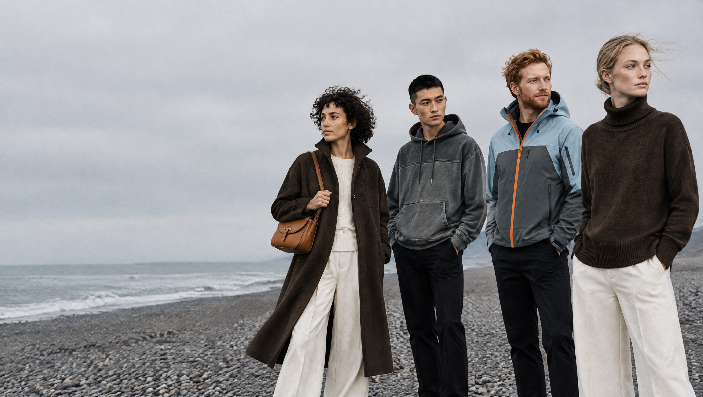
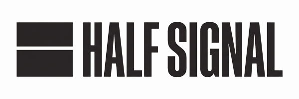
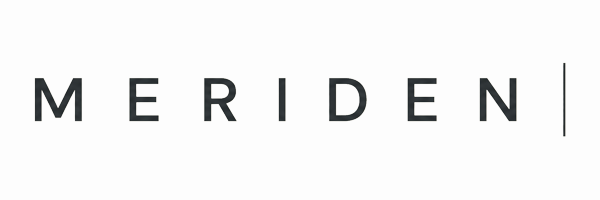
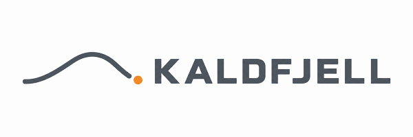
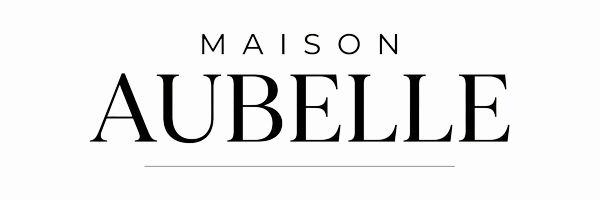
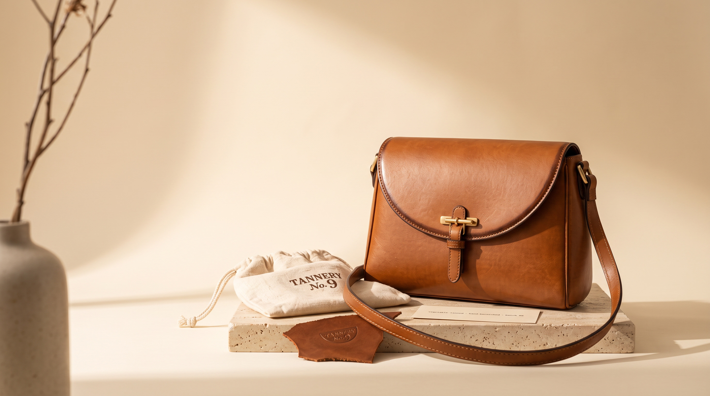
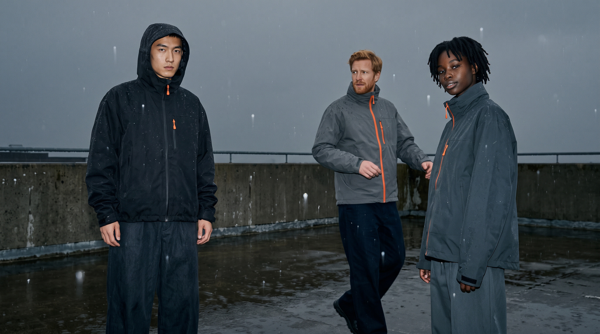
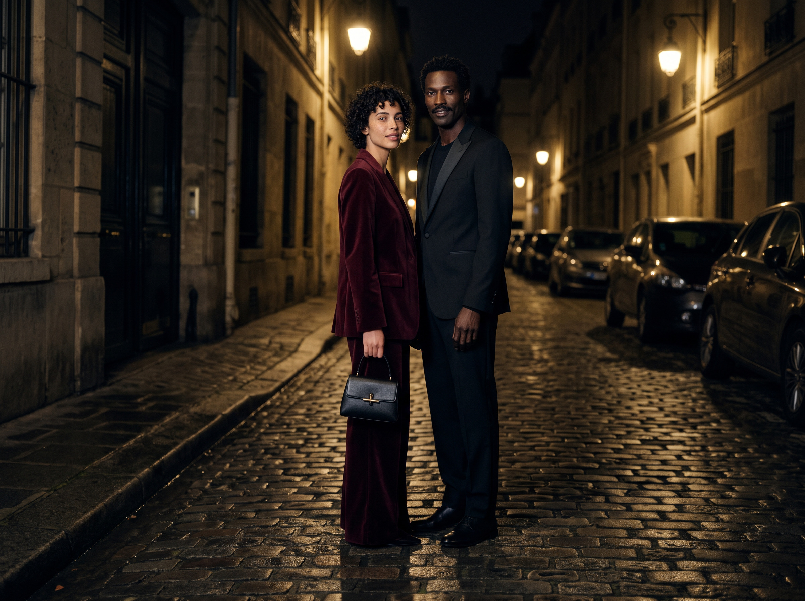

# FAST FORWARD Showroom

**A fictional fashion house you can load into any Salesforce B2C Commerce demo store.**



Five made-up labels, a recurring cast of synthetic models and products photographed consistently in every
colourway. No real brands, products or people. Every image was generated locally with openly licensed
(Apache 2.0) models, so the set is free to use commercially: in demos, pitches, products and training.

## Why use it

FAST FORWARD Showroom exists to show the FAST FORWARD storefront at its best.

**High-quality content.** Products are photographed on a consistent cast in every colourway, from the
front, side and back with a detail shot and a swatch, at the storefront's own tile ratio. Campaign imagery
sits beside it. The store reads as a real fashion retailer, not a demo with placeholder images.

**Brands and campaigns for content pages.** Five labels, each with a logo, a palette and its own voice,
plus seasonal campaigns. That is the material to build marketing content in Page Designer and show what
the storefront's content setup can do: the homepage ships as a Page Designer page built from its
components (campaign hero, category cards, label banner, product carousels, teasers).

**Products configured to trigger the storefront's flows.** Each product is set up to put the storefront
into a specific state, so every flow can be shown and tested on real data instead of mocks.

| Flow | Product | Since |
| --- | --- | --- |
| One size (no size selector) | Tannery No. 9 east-west bag | v0.2 |
| Promotion: sale price next to the list price | Half Signal hoodie | v0.2 |
| New-in badge | MERIDEN roll-neck jumper | v0.2 |
| Letter sizes versus numeric sizes | Kaldfjell shell (XS–XXL), Maison Aubelle coat (34–46) | v0.2 |
| Entry to premium price tiers | €25 socks to €1,200 coat | v0.2 |
| Reviews: none, one, a few, some, many | bag (none), jumper (1), coat (3), shell (9), hoodie (30) | v0.2 |
| More colours than the tile shows ("+1") | Half Signal hoodie (6 colours) | v0.2 |
| Sold-out colour (struck-through swatch) | Half Signal hoodie in Dusty Rose | v0.2 |
| Low stock | Kaldfjell half-zip fleece in Glacier Blue (2 left per size) | v0.2 |
| One size sold out | MERIDEN pleated trousers in Charcoal, size 36 | v0.2 |
| Backorder | Half Signal Signal Tee in Safety Red | v0.2 |
| Pre-order with an in-stock date | Tannery No. 9 east-west bag in Ivory | v0.2 |
| Scheduled sale (not active yet) | MERIDEN fly-front poplin shirt | v0.2 |
| Quantity price tiers | Half Signal rib sock 3-pack (1, 3 and 5 packs) | v0.2 |
| Minimum and step quantity | Half Signal rib sock 3-pack in Bone (2, then 2 at a time) | v0.2 |
| Size only, no colour choice | Tannery No. 9 oval-buckle belt | v0.2 |
| Priced product option | Tannery No. 9 oval-buckle belt (monogram, +€15) | v0.2 |
| Simple product (no variations) | Tannery No. 9 card holder | v0.2 |
| Product set | Maison Aubelle Après Minuit suit (jacket and trousers) | v0.2 |
| Bundle | Tannery No. 9 card and belt gift box | v0.2 |
| Coming soon (not online yet) | Kaldfjell light trail short | v0.2 |
| Online but not searchable | Tannery No. 9 dust bag | v0.2 |
| Order discount over a threshold | 10% off over €250 / £215 | v0.2 |
| Coupon codes | `SHOWROOM15` (15% off the order), `MERIDEN20` (20% off MERIDEN) | v0.2 |
| Free bonus product | the dust bag with the No. 9 bag | v0.2 |
| Shipping promotions, "spend X more" messages, choice of bonus, variation groups | a named product or promotion each | next |

Every scenario has an ID (`INV-02`, `TYP-05`, `PRM-08`, …). `scenarios.json`, attached to each release, lists
them with their host products, the data that was set and what the storefront should do; the hosts also carry the
IDs in a hidden `scenario` product attribute, so they are easy to find in Business Manager. Some scenarios ship
ahead of the storefront (the pre-order date, product options, minimum quantities, quantity tiers): the data is
there to build those flows against. Dates are set far in the future so nothing expires, and re-importing
`ff-v0.2.zip` resets every stock scenario after test orders.

Everything is fictional and generated with openly licensed models, so it is free to use commercially: in
demos, pitches and client sandboxes, with no rights questions.

## The labels

| Label | | What it is | Price range |
| --- | --- | --- | --- |
|  | **Half Signal** | Heavyweight streetwear and skate | €25–180 |
|  | **MERIDEN** | Scandinavian wardrobe essentials | €39–320 |
|  | **Kaldfjell** | Nordic technical outerwear | €29–450 |
|  | **Maison Aubelle** | Parisian tailoring | €180–1,200 |
|  | **Tannery No. 9** | Leather bags, shoes and small goods | €90–890 |

Each label's logo, transparent and on a white tile: [`brands/`](brands/).

## The campaigns

| | |
| --- | --- |
|  |  |
| **The No. 9 Bag**: the Tannery No. 9 drop | **Weather Report**: Half Signal × Kaldfjell |
|  |  |
| **Après Minuit**: Maison Aubelle with Tannery No. 9 | **First to know**: the newsletter image, watching the weather come in |

All five campaign images are in [`campaigns/`](campaigns/). The homepage import uses the first four; the newsletter image is meant for the footer.

## Use it

Download the import archives from the [latest release](https://github.com/geebelendries/fastforward-showroom/releases/latest)
and import them into a sandbox, in this order:

| Archive | What it does |
| --- | --- |
| `ff-v0.2.zip` | The catalogue: products, variants, images, categories, EUR and GBP prices, stock, plus the four promotions and their coupons |
| `site-switch.zip` | Points the `RefArchGlobal` site at the FAST FORWARD catalogue, prices and stock |
| `ff-home-v0.2.zip` | The homepage, as a Page Designer page in `RefArchSharedLibrary`, plus the label logos |
| `ff-reviews-v0.2.zip` | Customer reviews in a different mix per product, read by the FAST FORWARD reviews cartridge (optional) |
| `ff-v0.2-retire.zip` | Only when upgrading from v0.1: removes the colours v0.2 dropped |
| `site-rollback.zip` | Points the site back at the RefArch catalogue |

Import through **Business Manager → Administration → Site Development → Site Import & Export**, or with the
[B2C CLI](https://github.com/SalesforceCommerceCloud/b2c-developer-tooling):

```bash
b2c job import ff-v0.2.zip
```

Then rebuild the search index and clear the site page cache in Business Manager:

```bash
b2c job run sfcc-search-index-product-full-update -B '{"site_scope":["RefArchGlobal"]}' -w
```

An import merges, so running it again is safe. The reviews archive is the exception: it replaces each
product's review file, so reviews shoppers wrote on the instance since are lost. The homepage uses the Page Designer components of the FAST
FORWARD storefront, so that cartridge must be on the instance.

## Versions

### v0.2 (current, updated 2026-10-11)

The five pilot products redesigned and re-shot, thirteen more that put the storefront into its developer
scenarios, and the content to put them in a finished store.

| | |
| --- | --- |
| **Products** | 18. MERIDEN roll-neck jumper, pleated wide trousers, fly-front poplin shirt · Kaldfjell 3-layer shell, Weather Report half-zip fleece, light trail short · Half Signal heavyweight hoodie, Signal Tee, rib sock 3-pack · Maison Aubelle double-face coat, double-breasted barathea jacket, straight barathea trousers, the Après Minuit suit · Tannery No. 9 east-west bag, card holder, oval-buckle belt, card and belt gift box, dust bag |
| **Catalogue** | 14 masters with 246 colour × size variants, plus a simple product, a bundle, a set and a bonus product; 27 categories in menu order; EUR and GBP list, sale and tier prices; stock per scenario |
| **Scenarios** | Low stock, sold-out size, backorder, pre-order, scheduled sale, quantity tiers, minimum quantity, size-only, product option, simple product, set, bundle, coming soon, not searchable, four promotions (see `scenarios.json`) |
| **Design** | Each label has its own style (signature details, palette, what it never does) and the products follow the Fall/Winter 2026 and Spring/Summer 2027 trends |
| **Colourways** | 43 in all: 3 per product, 6 on the hoodie, 1 on the belt; five colours of v0.1 were replaced by stronger ones |
| **Photography** | Product photos, on-model views, still-lifes and details, 112 recolours and 42 swatches, at the storefront's tile ratio (325 : 462) so tiles show the whole frame |
| **Cast** | 8 people, a woman and a man per apparel label, plus the faceless Tannery No. 9 styling line, with the same face in every view |
| **Brands** | A logo per label |
| **Campaigns** | Five campaign images: the AW26 hero, the No. 9 Bag, Weather Report, Après Minuit and the newsletter |
| **Reviews** | 104 customer reviews in a different mix per product, from none to 30, as their own import |
| **Homepage** | A Page Designer homepage: campaign hero, category cards, label banner, new-in carousel and campaign teasers |

### v0.1 (2026-10-05)

The pilot: one product per label.

| | |
| --- | --- |
| **Products** | The same five product types, first designs |
| **Catalogue** | 5 masters, 81 variants, 18 categories, EUR and GBP prices, one flat stock level |
| **Photography** | 5 product photos, 20 on-model views, 40 recolours and 15 swatches, at 2 : 3 (tiles crop them slightly) |
| **Cast** | 4 people and the Tannery No. 9 styling line |

### Next

- **The full catalogue:** about 90 products across the five labels.
- **More scenarios:** variation groups, a product with no price in one currency, offline and expired products.
- **More promotions:** the rest of the flows the SFRA demo data covers: shipping discounts with and without a
  coupon, "spend X more" messages, a choice of bonus, discounts on qualifying products only, promotions that do
  not stack, and one for a customer group.
- **Localisation:** copy beyond English.
